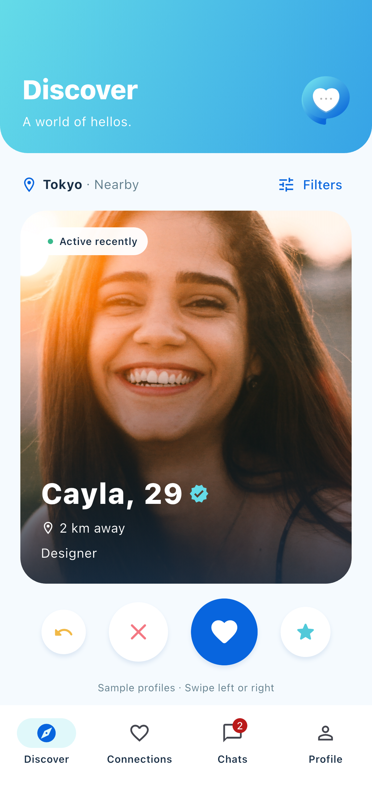
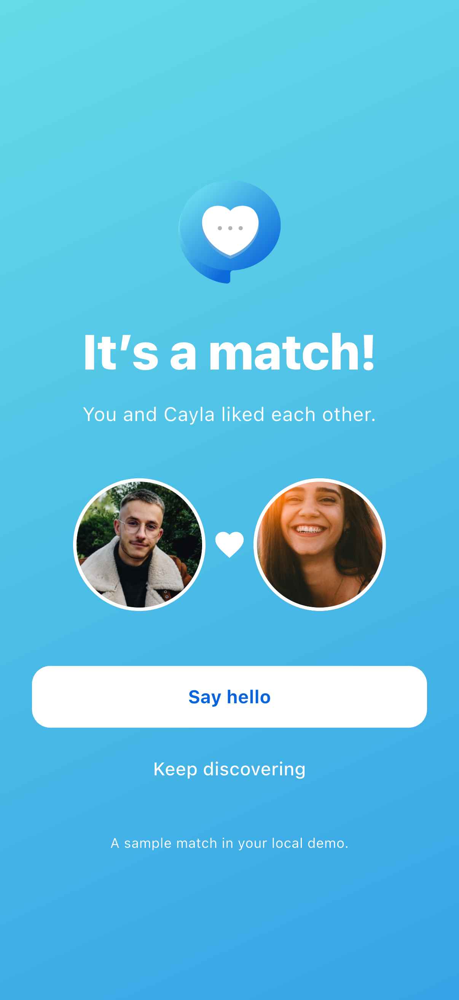
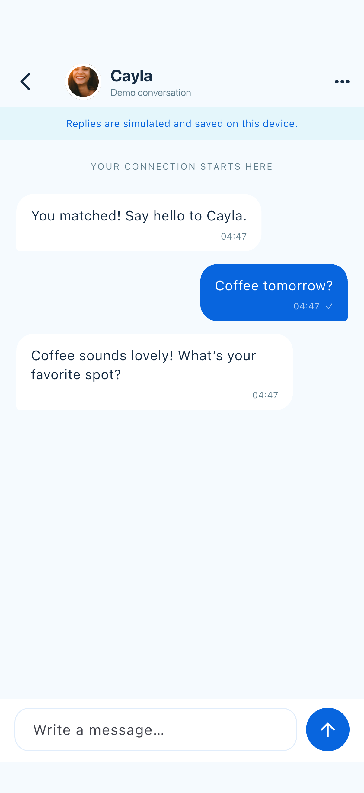
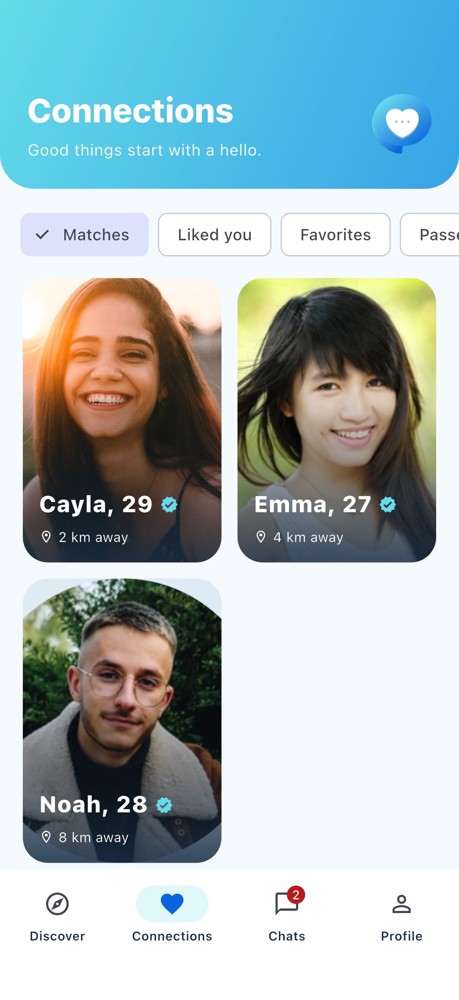
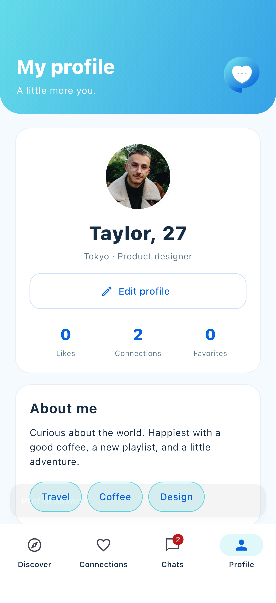

# Flutter 模拟器实际截图

来自 `integration_test/app_test.dart` 在 **iPhone 17 / iOS 26.0** 的实际运行。图片为 Flutter 版，旧 SwiftUI 截图在 `legacy/swiftui/docs/screenshots/`。

| 欢迎 | 发现 |
| --- | --- |
|  |  |

| 匹配 | 聊天 |
| --- | --- |
|  |  |

| 连接 | 个人资料 |
| --- | --- |
|  |  |

另含注册、兴趣选择、聊天列表、筛选空状态和设置截图，位于 `docs/screenshots/`。
